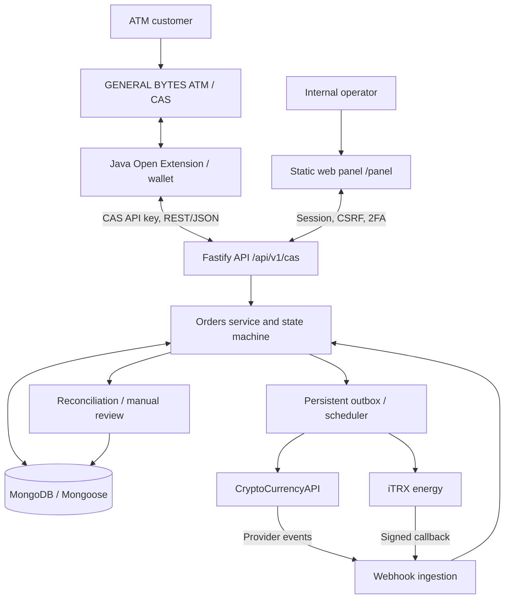

# XelerGo — GENERAL BYTES CAS USDT/TRON Integration

> **Technical README / maintainer handoff** · Source snapshot reviewed: 28 September 2026  
> **Scope:** Node.js transaction backend, internal operations panel, and GENERAL BYTES CAS Java extension.  
> **Deployment status:** Source implementation and tests are present; this document is **not** evidence of a successful production deployment, physical cash-dispense test, or completed end-to-end financial certification.

## Contents

1. [Overview](#overview)
2. [Supported use cases and boundaries](#supported-use-cases-and-boundaries)
3. [System architecture](#system-architecture)
4. [Repository map](#repository-map)
5. [End-to-end transaction flows](#end-to-end-transaction-flows)
6. [Order state machine](#order-state-machine)
7. [REST API reference](#rest-api-reference)
8. [External providers and asynchronous processing](#external-providers-and-asynchronous-processing)
9. [Persistence model](#persistence-model)
10. [Java CAS extension](#java-cas-extension)
11. [Administration panel](#administration-panel)
12. [Configuration and local development](#configuration-and-local-development)
13. [Building, testing and packaging](#building-testing-and-packaging)
14. [Security model](#security-model)
15. [Operations and troubleshooting](#operations-and-troubleshooting)
16. [Known limitations and verification gates](#known-limitations-and-verification-gates)
17. [Maintainer playbook](#maintainer-playbook)
18. [Detailed documentation and references](#detailed-documentation-and-references)

## Overview

XelerGo connects **GENERAL BYTES Crypto Application Server (CAS)** and its cryptocurrency ATMs to an independently operated backend that processes **USDT on TRON (TRC20)** against **Colombian pesos (COP)**. It supports two financial directions:

- **BUY:** a customer pays COP at an ATM; XelerGo arranges a USDT transfer from a configured central sender address to the customer's TRON address.
- **SELL:** a customer sends USDT to a per-order deposit address; the backend validates the deposit, arranges TRON energy, forwards the tokens to a central destination and authorizes the ATM to dispense COP. Only CAS's subsequent confirmation of cash payout finalizes the order.

The backend is the **system of record** for order state, provider interactions, asynchronous work, reconciliation and audit. The Java extension is an adapter to CAS, **not** an independent blockchain transaction processor. An authenticated internal web panel provides visibility and controlled operational interventions.

**Implementation stack:** Node.js 22+, npm 11+, TypeScript, Fastify 5, MongoDB/Mongoose, Zod, Pino, Vitest; Java extension built with Gradle (Java 8-compatible target bytecode, JDK 11 documented for building); CryptoCurrencyAPI and iTRX as external providers. The panel is served as static HTML/CSS/JavaScript by Fastify.

**Important scope restriction:** this source implements the `USDT` / `TRON` / `COP` integration; it is not a multi-chain exchange or a complete replacement for GENERAL BYTES CAS. Cash handling belongs to the ATM/CAS. Provider credentials, hot-wallet funding and external subscriptions are deployment prerequisites.

## Supported use cases and boundaries

| Component | Responsible for | Not responsible for |
| --- | --- | --- |
| GENERAL BYTES ATM/CAS | User interaction, fiat acceptance/dispensing, terminal and transaction lifecycle | Internal XelerGo order processing |
| Java extension (`src/`) | CAS wallet interface, CAS ↔ REST translation, order links, polling, mapping statuses, SELL payout acknowledgment | Direct TRON sends, business state machine, financial reconciliation |
| TypeScript API (`backend/src/`) | Order validation/state machine, provider calls, webhooks, persistence, asynchronous jobs and audit | Physically verifying or dispensing cash itself |
| CryptoCurrencyAPI | Deposit address (`give`), token forwarding (`forward`), sender transfer (`send`), provider tracking/events | CAS cash handling |
| iTRX | TRON energy rental/confirmation for deposit and sender addresses | Fiat handling or independently confirming customer cash receipt |
| Internal panel (`backend/panel/`) | Operations, searches, audit, notes, settings, controlled manual actions | Replacing provider confirmations or circumventing state invariants |

## System architecture



### Architectural conventions

- `backend/src/app`: application composition, Fastify bootstrapping, environment validation, HTTP plugins, docs and route registration.
- `backend/src/modules`: request schemas, route definitions, thin controllers and application services, grouped by feature.
- `backend/src/domain`: state machine, domain rules, entities, repository contracts and errors.
- `backend/src/infrastructure`: Mongoose models/repositories, provider clients, TRON helper, encryption, Mongo locks, outbox and logging.
- `backend/src/jobs`: persistent scheduler, financial-operation guards and external-effect execution context.
- `backend/src/shared`: common constants, serializers, types, validation and utilities.
- **Do not** move blockchain orchestration into Java or let a CAS status bypass server-side transaction invariants.

## Repository map

The supplied snapshot has an **extension-first root** rather than the `extension/` child layout mentioned in some older backend documentation. Use these actual paths when working with this archive:

```text
.
├── README.md                         # Existing extension-oriented overview
├── BACKEND_INTEGRATION.md             # CAS/backend handshake notes
├── GB_EXTENSION_SETUP.md              # CAS configuration and installation
├── GB_PRODUCTION_READINESS.md          # Extension readiness notes
├── FINAL_PRODUCTION_VALIDATION_CHECKLIST.md
├── build.gradle, settings.gradle      # Java extension build
├── gradlew, gradlew.bat, gradle/       # Gradle wrapper
├── src/main/java/com/xelergo/gb/extension/
├── src/main/resources/                 # Service registration and batm-extensions metadata
├── src/test/                           # Lightweight Java test suite
├── stubs/                              # LOCAL compile/test API stubs, not official API authority
├── build/libs/                         # Existing packaged JAR; regenerate before a release
└── backend/
    ├── src/app/, src/modules/, src/domain/, src/infrastructure/, src/jobs/
    ├── src/tests/{unit,integration,e2e}/
    ├── panel/{index.html,app.js,styles.css}
    ├── docs/                            # Detailed backend references
    ├── package.json, package-lock.json, tsconfig.json, vitest.config.ts
    ├── package-extension.ps1            # Packaging script; check historical path assumptions
    └── dist/                            # Generated JS, not the TypeScript source of truth
```

**Critical files / where to change things:**

| Goal | Primary source files |
| --- | --- |
| Application startup and DI | `backend/src/app/bootstrap.ts`, `app.ts`, `server.ts`, `routes.ts`, `config/env.ts` |
| CAS API and correlation rules | `backend/src/modules/cas/{cas.routes,cas.controller,cas.schemas}.ts`; `orders/orders.service.ts` |
| Order transitions / allowed statuses | `backend/src/domain/state-machine/order-state-machine.ts`, `domain/enums/order-status.ts` |
| Deposit amount/confirmation validation | `backend/src/domain/services/deposit-validation.service.ts` |
| External-effect outcome and send/forward policies | `backend/src/domain/services/{external-operation-outcome,send-policy,forward-policy}.service.ts` |
| Energy selection and execution | `backend/src/domain/services/energy-selection.service.ts`, `backend/src/modules/energy/energy.service.ts` |
| Provider adapters | `backend/src/infrastructure/providers/{cryptocurrencyapi,itrx}/` |
| Webhook signature/normalization/handling | `backend/src/modules/webhooks/`, `backend/src/infrastructure/providers/*/*.mapper.ts`, `itrx/itrx.signature.ts` |
| Durable work, retries, locks | `backend/src/infrastructure/queue/outbox.service.ts`, `backend/src/jobs/`, `backend/src/infrastructure/locks/mongo-lock.service.ts` |
| Recovery and state repair | `backend/src/modules/reconciliation/reconciliation.service.ts` |
| Database records and indices | `backend/src/infrastructure/db/models/`, `repositories/`, `indexes/` |
| CAS callback integration | `src/main/java/com/xelergo/gb/extension/XelerGoExtension.java` |
| CAS polling and recovery | `XelerGoTransactionSyncTask.java`, `XelerGoOrderLinkRegistry.java` |
| Java ↔ backend transport | `XelerGoApiClient.java`, `XelerGoJson.java`, `XelerGoApiException.java` |
| CAS state translation | `XelerGoStatusMapper.java` |
| Wallet methods and synthetic balance | `XelerGoWallet.java` |
| CAS configuration and address checks | `XelerGoConfig.java`, `XelerGoConfigRegistry.java`, `TerminalIdResolver.java`, `TronAddressValidator.java` |
| Panel routes, permission checks, operations | `backend/src/modules/panel/`, `backend/panel/`, `backend/src/modules/auth/` |
| Logs, tracing and records | `XelerGoLogger.java`, `XelerGoTrace.java`, `backend/src/infrastructure/logger/pino.ts`, `backend/src/modules/audit/` |

## End-to-end transaction flows

### SELL: customer sends USDT, ATM pays COP

1. CAS invokes the extension's SELL/deposit-address flow. Java creates a SELL order at `POST /api/v1/cas/sell-orders`, including CAS transaction correlation and amount details.
2. The backend obtains a per-order TRON deposit address from CryptoCurrencyAPI **`give` without a forwarding `to` address**, stores correlation data and presents an address/QR to CAS. The order reaches `WAITING_DEPOSIT`.
3. A CryptoCurrencyAPI callback/IPN records a deposit event. The backend normalizes/correlates the event, checks asset/network, amount and confirmation policy, and transitions to `DEPOSIT_DETECTED` when valid.
4. An outbox job requests energy for the deposit address through iTRX (selection/floor/cap/retry policy is configurable). Its signed callback confirms the energy operation.
5. A separate asynchronous CryptoCurrencyAPI `forward` transfers the received USDT to the configured central address. Provider confirmation moves the order through sweep confirmation to `READY_FOR_PAYOUT`.
6. Java polling maps the backend result to the appropriate CAS transaction state. **`READY_FOR_PAYOUT` means cash may be dispensed; it does not mean it was dispensed.**
7. After CAS reports the transaction withdrawn (`isWithdrawn()`), Java calls `POST /api/v1/cas/sell-orders/:orderId/complete-payout`.
8. The backend validates SELL type, CAS transaction reference, configured terminal correlation and current state, then transitions `READY_FOR_PAYOUT → COMPLETED`; a repeat on an already completed order is idempotent.

**Failure paths:** expiration before deposit, post-expiration/cancellation late deposits (`LATE_DEPOSIT`), retryable provider failures, and manual review. Never equate provider acceptance with confirmed sweep or physically completed cash payment.

### BUY: customer pays COP, backend sends USDT

1. CAS records the purchase and destination TRON address. Java validates the destination and sends `POST /api/v1/cas/buy-orders` with the COP amount, USDT amount, `externalRef` and terminal.
2. Backend creates the BUY order and validates it. The configured `TRON_BUY_SENDER_ADDRESS` acts as the central sender.
3. Energy selection requests estimated/fixed iTRX energy, or reuses a currently recorded valid confirmation for the sender when the policy permits it.
4. Once energy is confirmed, the durable outbox performs CryptoCurrencyAPI `send` asynchronously.
5. A provider callback/tracking/reconciliation establishes broadcast/delivery outcome; the state machine reaches `COMPLETED` on accepted evidence of delivery, with the real blockchain transaction ID retained.
6. Java `sendCoins()` **does not send on-chain**: it returns the existing backend `orderId` as a logical reference. Polling subsequently associates the real `txid` with the CAS transaction.

**Do not** interpret `SEND_ACCEPTED` or `SEND_BROADCASTED` alone as confirmed customer delivery. Timeout/unknown-outcome handling must reconcile with the provider before any repeat send to avoid duplicate payment.

### Sequence of trust

CAS confirms physical events; the backend validates transaction inputs and provider evidence; provider callbacks are normalized/verified; the order state machine authorizes transitions; persistent job/lock controls limit repeated external effects. Neither a browser action nor a Java UI status should independently finalize an uncertain financial operation.

## Order state machine

Canonical definitions live in `backend/src/domain/enums/order-status.ts` and transition rules in `backend/src/domain/state-machine/order-state-machine.ts`. Documentation: [`backend/docs/state-machine.md`](backend/docs/state-machine.md).

**Typical SELL:** `CREATED → ADDRESS_ASSIGNED → WAITING_DEPOSIT → DEPOSIT_DETECTED → [ENERGY_ESTIMATION_REQUESTED → ENERGY_ESTIMATED] → ENERGY_REQUESTED → ENERGY_CONFIRMED → FORWARD_REQUESTED → FORWARD_ACCEPTED → SWEEP_CONFIRMED → READY_FOR_PAYOUT → COMPLETED`.

**Typical BUY:** `CREATED → VALIDATED → [ENERGY_ESTIMATION_REQUESTED → ENERGY_ESTIMATED] → ENERGY_REQUESTED → ENERGY_CONFIRMED → SEND_REQUESTED → SEND_ACCEPTED → SEND_BROADCASTED → DELIVERY_CONFIRMED → COMPLETED`. Actual legal shortcuts and recovery transitions are defined in code; e.g., energy reuse can bypass rental, and a provider may confirm delivery without every intermediate state.

Shared/error outcomes also include `CANCELED`, `ERROR_RETRYABLE` and `ERROR_MANUAL_REVIEW`; SELL additionally has `EXPIRED` and `LATE_DEPOSIT`. `READY_FOR_PAYOUT` has different contextual meaning and **SELL cannot be marked complete without the cash confirmation contract**. Every transition is audited in `order_state_transitions`.

## REST API reference

**Prefix:** `/api/v1` · JSON body/response · CAS and internal endpoints use separate `X-API-Key` credentials (`x-api-key` is case-insensitive). The request trace may be propagated through `X-Request-Id`. Most JSON responses use `{ "success": true, "data": ..., "meta": { "requestId": "..." } }` or an error envelope. Exact schemas and status codes: [`backend/docs/api-contract.md`](backend/docs/api-contract.md); running OpenAPI: `GET /docs` and `GET /docs/json`.

### CAS endpoints (CAS API key)

| Method | Path | Purpose |
| --- | --- | --- |
| POST | `/api/v1/cas/sell-orders` | Create a SELL and assign deposit destination |
| GET | `/api/v1/cas/sell-orders/:orderId` | Read SELL state and provider/deposit details |
| GET | `/api/v1/cas/sell-orders/:orderId/timeline` | Ordered state/event history |
| POST | `/api/v1/cas/sell-orders/:orderId/cancel` | Cancel while permitted (`CREATED`, `ADDRESS_ASSIGNED`, `WAITING_DEPOSIT`) |
| POST | `/api/v1/cas/sell-orders/:orderId/complete-payout` | Acknowledge physically dispensed cash and complete SELL |
| POST | `/api/v1/cas/buy-orders` | Create BUY and register recipient/amount |
| GET | `/api/v1/cas/buy-orders/:orderId` | Read BUY state, send reference and txid if present |
| GET | `/api/v1/cas/buy-orders/:orderId/timeline` | Ordered BUY history |
| POST | `/api/v1/cas/buy-orders/:orderId/cancel` | Cancel only before send has been requested |

**Representative BUY creation** (illustrative address and amounts; use an actual checksum-valid customer address):

```json
{
  "asset": "USDT", "network": "TRON", "fiatCurrency": "COP",
  "fiatAmount": 100000, "cryptoAmountToSend": 24.12,
  "customerDestinationAddress": "<valid TRON address>",
  "externalRef": "cas-tx-buy-123", "terminalId": "batm-001"
}
```

**Representative payout acknowledgment:**

```http
POST /api/v1/cas/sell-orders/{orderId}/complete-payout
X-API-Key: <CAS_API_KEY>
Content-Type: application/json

{"casTransactionId":"cas-tx-123","terminalId":"batm-001"}
```

The backend checks SELL type, order reference and terminal when stored, and requires `READY_FOR_PAYOUT` unless already `COMPLETED`. Successful response reports `COMPLETED`. **An arbitrary HTTP 409 must not be assumed to mean “already completed”; inspect the current server state.** For creation field details, including SELL `cryptoAmountExpected`, deposit response/QR and optional fields, use the contract and Zod schemas rather than inventing request fields.

### Provider callbacks

| Method | Path | Purpose |
| --- | --- | --- |
| POST | `/api/v1/webhooks/cryptocurrencyapi` | CryptoCurrencyAPI deposit, forward/sweep and BUY send events |
| POST | `/api/v1/webhooks/itrx` | Signed iTRX energy callback |

These routes do not use the CAS API key. CryptoCurrencyAPI correlation can use provider `uniqID`, label, deposit address or request ID. Events are durably recorded and deduplicated by event key. iTRX validates HMAC-SHA256 over `timestamp + "&" + canonical_json_body` and a configured timestamp window; invalid callbacks cannot mutate financial state. Configure provider callback URLs using the public `API_BASE_URL`.

### Internal / admin endpoints

These **require separate internal authentication and must not be exposed as public CAS capabilities**:

| Method | Path | Purpose |
| --- | --- | --- |
| GET | `/api/v1/internal/orders` | Internal order search |
| GET | `/api/v1/internal/orders/:orderId` | Internal order detail |
| POST | `/api/v1/internal/orders/:orderId/request-energy` | SELL deposit-address energy |
| POST | `/api/v1/internal/orders/:orderId/request-buy-energy` | BUY central-sender energy |
| POST | `/api/v1/internal/orders/:orderId/forward` | Trigger SELL forward workflow |
| POST | `/api/v1/internal/orders/:orderId/send-buy` | Trigger BUY send workflow |
| POST | `/api/v1/internal/orders/:orderId/reconcile` | Reconcile provider/order status |
| POST | `/api/v1/internal/orders/:orderId/mark-manual-review` | Flag an order for intervention |
| POST | `/api/v1/internal/provider-events/:eventId/reprocess` | Controlled provider-event reprocessing |
| GET | `/api/v1/admin/maintenance/storage` | Storage-maintenance inspection |
| POST | `/api/v1/admin/maintenance/storage/cleanup` | Authorized maintenance cleanup |

Exact auth and action preconditions are defined in their route files. Do not blindly reissue a financial POST when an external effect has an unknown outcome.

### Panel and service endpoints

| Method/path | Purpose |
| --- | --- |
| `GET /health`, `GET /live`, `GET /ready` | Health, process liveness and MongoDB readiness |
| `GET /docs`, `GET /docs/json` | Swagger UI / generated OpenAPI |
| `GET /panel` | Internal operations UI |
| `POST /panel/api/auth/login`, `GET /panel/api/auth/me`, `POST /panel/api/auth/logout` | Session lifecycle |
| `POST /panel/api/auth/step-up`, `/auth/2fa/setup`, `/auth/2fa/confirm`, `/auth/password/change` | Strong authentication lifecycle |
| `GET /panel/api/auth/sessions`, `POST /panel/api/auth/sessions/close-others` | Session management |
| `GET /panel/api/dashboard`, `/orders`, `/orders/:orderId`, `/provider-events`, `/audit/logs` | Monitoring and audit |
| `POST /panel/api/orders/:orderId/notes` | Operator notes |
| `POST /panel/api/orders/:orderId/actions/:action` | Permission-controlled operational actions |

Additional users, settings, connection tests, reports/exports and profile routes are documented by source: `backend/src/modules/panel/panel-auth.routes.ts` and `panel.routes.ts`. Mutations generally require session + CSRF; critical actions require fresh step-up and an appropriate role.

## External providers and asynchronous processing

- **CryptoCurrencyAPI:** `give` assigns SELL deposit addresses; `forward` sweeps SELL tokens; `send` fulfills BUY; `track`/callbacks support evidence collection and reconciliation. The transport, mapping and business wrapper are under `backend/src/infrastructure/providers/cryptocurrencyapi/`.
- **iTRX:** rental pricing/energy requests and authenticated callbacks. Separate energy contexts `SELL_DEPOSIT` and `BUY_SENDER`; energy mode, limits, reuse and fallback are configured separately for BUY/SELL. Source: `backend/src/infrastructure/providers/itrx/`, `backend/src/modules/energy/`.
- **Persistent outbox:** `outbox_jobs` stores work and retry scheduling. Job types: `REQUEST_ENERGY`, `REQUEST_BUY_ENERGY`, `REQUEST_FORWARD`, `SEND_BUY`, `EXPIRE_ORDER`, `RECONCILE_ORDER`, `REPROCESS_PROVIDER_EVENT`, `MARK_MANUAL_REVIEW`. Scheduler: `backend/src/jobs/scheduler.ts`.
- **Mongo distributed locks:** lock key `order:{orderId}` with TTL; prevents overlapping financial operations on the same order. They are not a replacement for provider-side idempotency and unknown-outcome reconciliation.
- **External-effect guard:** code in `backend/src/jobs/external-effect-guard.ts` and `financial-job-execution-context.ts` handles uncertain effects; investigate the provider before retrying any potentially executed transfer.
- **Reconciliation:** `backend/src/modules/reconciliation/reconciliation.service.ts` examines persisted states/provider evidence and routes uncertain or inconsistent cases to retry/manual review rather than assuming success.

## Persistence model

MongoDB collections represented by Mongoose models in `backend/src/infrastructure/db/models/`:

| Collection | Function |
| --- | --- |
| `orders` | Canonical BUY/SELL order, CAS refs, addresses, amounts, provider IDs, timestamps, final/error status |
| `provider_events` | Stored/raw callbacks, event-key deduplication, signature and processing outcome |
| `energy_requests` | iTRX request and confirmation history / energy context |
| `forward_requests` | SELL forwarding attempts, provider refs, txid and outcome |
| `send_requests` | BUY transfer attempts, provider refs, txid and outcome |
| `order_state_transitions` | Append-oriented state-change audit |
| `distributed_locks` | Per-order mutual exclusion and TTL |
| `outbox_jobs` | Persistent work, retries, locking and timestamps |
| `internal_users`, `admin_sessions`, `admin_audit_logs` | Panel identity, sessions and privileged-action audit |
| `order_notes` | Support/operations notes |
| `system_settings` | Runtime-configurable panel settings |

Never weaken unique provider/event identifiers or change monetary state solely from an untrusted callback. Inspect [`backend/docs/collections-and-indexes.md`](backend/docs/collections-and-indexes.md), `order.model.ts`, and the index migration scripts before database changes. Specific maintenance utilities exist in `backend/src/scripts/` for deposit-observed transaction ID indexing, distributed lock indexes, storage analysis/retention and BUY smart-delegate policy.

## Java CAS extension

### Lifecycle and registration

`XelerGoExtension.java` supplies the CAS integration callbacks and registers a transaction sync task. `XelerGoWallet.java` implements required wallet-facing methods; `XelerGoApiClient.java` performs authenticated JSON calls; `XelerGoTransactionSyncTask.java` periodically retrieves CAS transactions and synchronizes linked backend orders. Service loader registration and extension metadata are in `src/main/resources/META-INF/services/`, `batm-extensions.xml`, `batm-extensions.properties`.

`XelerGoOrderLink` / `XelerGoOrderLinkRegistry` associate CAS remote transaction ID, `orderId`, terminal and configuration. `customData` facilitates recovery across task restarts. `XelerGoStatusMapper` maps backend statuses to CAS semantics. `TronAddressValidator` checks TRON Base58Check destination addresses.

### Wallet configuration

Wallet prefix: `xelergo`. Documented format:

```text
xelergo:apiProtocol:apiHost:apiPort:apiBasePath:apiKey:connectTimeoutMs:readTimeoutMs:terminalIdMode:staticTerminalId:pollingSeconds:lookbackHours
```

Follow [`GB_EXTENSION_SETUP.md`](GB_EXTENSION_SETUP.md) and `XelerGoConfig.java` for valid values, defaults, serialization and CAS-side setup. `apiBasePath` is the prefix **before** `/api/v1/cas` (typically blank, `/`, or `/api`); do not create duplicate `/api/api/v1/cas` paths. `pollingSeconds` defaults to 15 seconds in the extension. It intentionally supports **one safely resolvable configuration per CAS instance**, rather than silently mapping transactions to a wrong wallet configuration. Unresolved historical `configKey` should fail closed and be investigated.

### Integration caveats

1. `XelerGoWallet.getCryptoBalance()` currently returns a **synthetic `USDTTRON` balance**, not hot-wallet/on-chain liquidity. Never use this figure as evidence that an ATM can safely fulfill a purchase.
2. `sendCoins()` returns a pre-created logical backend order ID, **not** an immediate blockchain TXID. Later synchronization writes the confirmed txid into CAS. Validate that behavior against the exact deployed CAS release.
3. CAS cash withdrawal is the authoritative physical input for SELL `complete-payout`; backend `READY_FOR_PAYOUT` alone does not mean cash has been paid.
4. Any error such as HTTP `409` must be classified by its actual body and fresh order state; do not report every conflict as an idempotently completed payout.
5. Local `stubs/` are for self-contained compile/tests, **not** proof of compatibility with every official GENERAL BYTES build.

### Upstream API compatibility

Reference used by the project: [GENERAL BYTES `batm_public`](https://github.com/GENERALBYTESCOM/batm_public), `master`, commit `e9db1f965b784d9bc7c2c89e5c463f61d602eee2`. Review the exact public API surface used by `IExtension`, transaction listener, wallet/deposit address interfaces and CAS update/hash methods; run the project's official API verification task against an appropriately obtained checkout. Always retest when upgrading CAS.

## Administration panel

Static assets: `backend/panel/index.html`, `app.js`, `styles.css`; served by Fastify. Main capabilities include dashboard metrics, BUY/SELL search, order details/timelines, provider-event visibility, notes, audit logs, reports/exports, settings and connection checks, internal users, password/2FA/session management, and controlled manual actions (reconcile/retry/cancel/review/outcome resolution, subject to actual permissions and states).

Authorization is **server-side**. `backend/src/modules/panel/panel-auth.guard.ts` enforces session, permission and CSRF; critical actions also require fresh step-up. Consult `backend/ADMIN_PANEL_IMPLEMENTATION.md` and `backend/ADMIN_PANEL_REFINEMENT.md` for panel-specific design history.

## Configuration and local development

> **SECURITY WARNING ABOUT THE SUPPLIED ARCHIVE:** `backend/.env` is included alongside `backend/.env.example`. Treat the real `.env` as potentially secret; **do not commit or publish it**, and rotate any credential that has been exposed in a public/shared archive or repository. The supplied `backend/backend.zip` is another nested archive; inspect/sanitize its contents before publishing. This README deliberately reproduces no secret values.

Prerequisites: Node.js **22+**, npm **11+**, MongoDB, configured provider sandbox/test accounts or safely isolated mocks; JDK 11 for the documented Java build. Work from the actual `backend/` directory:

```bash
cd backend
npm ci
cp .env.example .env    # Windows PowerShell: Copy-Item .env.example .env
# Set non-production local values; keep credentials outside Git.
npm run dev
```

Important environment **names** (not secret values):

| Category | Key examples |
| --- | --- |
| Core | `NODE_ENV`, `PORT`, `API_BASE_URL`, `MONGODB_URI`, `MONGODB_DB_NAME`, `LOG_LEVEL` |
| Client authorization | `CAS_API_KEY`, `INTERNAL_API_KEY` |
| CryptoCurrencyAPI | `CRYPTOCURRENCY_API_BASE_URL`, `CRYPTOCURRENCY_API_KEY`, `CRYPTOCURRENCY_API_TIMEOUT_MS`, `CRYPTOCURRENCY_API_IP_ALLOWLIST` |
| iTRX | `ITRX_API_BASE_URL`, `ITRX_API_KEY`, `ITRX_API_SECRET`, `ITRX_API_TIMEOUT_MS`, `ITRX_CALLBACK_MAX_AGE_SEC`, `ITRX_IP_ALLOWLIST` |
| Addresses/token | `TRON_FORWARD_TARGET_ADDRESS`, `TRON_BUY_SENDER_ADDRESS`, `TRON_USDT_TOKEN_SYMBOL` |
| Deposits/order limits | `ORDER_DEFAULT_WAIT_PERIOD_MIN`, `MIN_CONFIRMATIONS_USDT_TRC20`, `MIN_OPERATIONAL_USDT`, `MIN_OPERATIONAL_USDT_BUY`, `ALLOW_PARTIAL_DEPOSITS`, `AMOUNT_TOLERANCE_PERCENT` |
| Energy | `ENERGY_MODE`, `ENERGY_MODE_BUY`, `ENERGY_FIXED_AMOUNT*`, `ENERGY_SAFETY_MULTIPLIER*`, `ENERGY_MIN_FLOOR*`, `ENERGY_MAX_CAP*`, `ENERGY_RENTAL_PERIOD` |
| Sends/retries | `BUY_SEND_REQUIRE_EXACT_SENDER_MATCH`, `BUY_SEND_MIN_CONFIRMATIONS`, `BUY_SEND_BROADCASTED_TIMEOUT_MINUTES`, `FORWARD_MAX_RETRY_COUNT`, `BUY_MAX_RETRY_COUNT` |
| Workers/security | `SCHEDULER_ENABLED`, `SCHEDULER_POLL_MS`, `LOCK_TTL_SEC`, `INTERRUPTED_OPERATION_POLICY`, `RATE_LIMIT_MAX`, `CORS_ORIGINS`, `WEBHOOK_REQUIRE_IP_ALLOWLIST` |
| Encryption/panel | `STORE_ENCRYPTED_PRIVATE_KEYS`, `PRIVATE_KEY_ENCRYPTION_SECRET`, `PANEL_ENCRYPTION_SECRET`, `PANEL_SESSION_TTL_HOURS`, `PANEL_STEP_UP_TTL_MIN`, `PANEL_BOOTSTRAP_ADMIN_*` |

Read `backend/.env.example`, `backend/src/app/config/env.ts` and [`backend/docs/env.example.md`](backend/docs/env.example.md) for the complete authoritative environment contract. Never use real transfers as a local smoke test. A local provider webhook needs a deliberately configured accessible callback URL; no local tunnel is bundled.

## Building, testing and packaging

### Backend

```bash
cd backend
npm ci
npm run lint
npm test
npm run build
npm start
```

Test suites: `backend/src/tests/unit/` (domain/provider/security rules), `integration/` (workflow, scheduler restart, index and maintenance behavior), `e2e/` (API, panel and maintenance). Uses Vitest, Supertest, Nock and `mongodb-memory-server`. Run tests against a disposable datastore and mock all external financial side effects. The existence of these tests in the archive **does not assert that they passed in this review**.

Maintenance scripts (read their flags/code before execution):

```bash
npm run orders:migrate-deposit-index -- --dry-run
npm run locks:migrate-indexes
npm run storage:analyze
# Any --apply / cleanup / policy-changing action needs backup and change approval.
```

### Java extension

From repository root on Windows:

```powershell
.\gradlew.bat build
.\gradlew.bat verifyOfficialApiContracts
```

`build.gradle` defines a lightweight `runExtensionTests` JavaExec task. Its Gradle `test` task depends on that runner and is itself disabled; therefore inspect **the runner result**, not an apparently skipped default JUnit task. The actual runnable compatibility task names and prerequisites should be checked against the current `build.gradle` before relying on any historical docs. The generated artifact is `build/libs/xelergo_generalbytes_extension.jar`.

The `backend/package-extension.ps1` and existing documentation were authored for an earlier parent/`extension/` directory arrangement. **Confirm its input/output paths against this archive's extension-first layout before executing packaging**. Do not publish stale `build/` or `dist/` files instead of building from source. Separate release procedures should pin the backend commit, extension JAR checksum and verified CAS version.

### Minimum pre-release evidence

- Fresh backend lint/test/build and extension runner/API-surface checks.
- Migration dry runs, index checks, encrypted-secret and log reviews.
- Real deployed backend ↔ exact JAR contract test (not merely local stubs).
- Replay/duplicate callbacks, restart recovery, unknown provider outcome and concurrent order tests.
- Non-financial CAS integration validation, then explicitly authorized controlled financial test with independent balance/cash reconciliation.
- Recorded exact versions, sanitized logs, rollback steps and operator sign-off. See [`FINAL_PRODUCTION_VALIDATION_CHECKLIST.md`](FINAL_PRODUCTION_VALIDATION_CHECKLIST.md).

## Security model

- Separate API keys for CAS and internal endpoints. Do not put either in browser code.
- Panel authentication uses password hashing, session cookies (`HttpOnly`), CSRF, mandatory TOTP 2FA and recent step-up for sensitive actions; backend role checks are authoritative.
- iTRX callbacks validate signed canonical content and age. CryptoCurrencyAPI callbacks are persisted, normalized and deduplicated; optional source IP restrictions should be configured according to provider guidance.
- Configurable rate limiting, Helmet and CORS. Correlate operational requests by `requestId`, `orderId`, `externalRef`, `terminalId`, provider ID and txid.
- Private keys must not be logged or stored in cleartext; when enabled, private key storage uses AES-256-GCM. Panel-held sensitive settings/TOTP secrets have dedicated encryption.
- Provider response excerpts and raw callback storage require a redaction/access-control/retention review. Restrict MongoDB backups and admin exports.
- **Never commit `.env`**, private material or a nested archive that includes them. Before first public push: check all ZIP contents, repo history and build output; revoke/rotate exposed secrets.

See [`backend/docs/seguridad.md`](backend/docs/seguridad.md) and the source guards/signature functions for implementation details; documentation is not a substitute for a security assessment.

## Operations and troubleshooting

| Symptom | Start investigation at | Avoid |
| --- | --- | --- |
| CAS cannot connect | `XelerGoConfig`, `XelerGoApiClient`, URL prefix, CAS key, network/TLS and request IDs | Changing wallet credentials blindly |
| Duplicate/missing CAS order association | `XelerGoOrderLinkRegistry`, CAS `customData`, backend `externalRef` and `terminalId` | Falling back to a different config/key |
| SELL stuck waiting | Order timeline, `provider_events`, deposit address/txid, confirmations, amount policy | Marking a missing deposit as paid |
| SELL energy/forward stalled | `energy_requests`, `forward_requests`, iTRX callback signature, `outbox_jobs`, provider tracking | Repeating an uncertain forward without reconciliation |
| SELL says ready but not completed | CAS cash `isWithdrawn()`, Java sync logs, `complete-payout` response and backend correlation | Treating ready-for-payout as paid |
| BUY accepted/broadcast but no final txid | `send_requests`, provider tracking/webhook, `SEND_BROADCASTED` timeout, reconciliation | Issuing another send based only on a timeout |
| Unexpected HTTP 409 | Response error code, current order state and CAS correlation | Automatically labeling it “already completed” |
| Jobs stop after restart | Scheduler enabled, `outbox_jobs` due/locked state, TTL locks, restart integration tests | Deleting locks/jobs without evidence |
| Panel action denied | Session, role, CSRF, 2FA step-up, `admin_audit_logs` | Bypassing backend authorization |
| Failed readiness | `GET /ready`, Mongo connectivity, environment validation | Equating `/live` with financial readiness |

For production, use HTTPS, durable shared MongoDB, controlled scheduler instances, backup/restore testing and alerts on `ERROR_MANUAL_REVIEW`, `LATE_DEPOSIT`, failed outbox work, unprocessed provider events and long-lived send outcomes. Rollback must consider DB/schema and state-machine compatibility, not just revert executable files.

## Known limitations and verification gates

These are **actionable engineering concerns**, not assertions that actual customer funds were lost:

1. **Synthetic CAS liquidity:** `XelerGoWallet.getCryptoBalance()` reports a fixed synthetic balance. Add an authoritative balance/availability contract and verify the complete CAS behavior before real BUY operations.
2. **CAS version qualification:** local API stubs and source-surface checks do not replace end-to-end qualification on the exact GENERAL BYTES server version and hardware/cash configuration.
3. **`sendCoins()` reference semantics:** Java returns logical `orderId` before real txid exists. Confirm CAS state/hash update behavior and no premature success.
4. **SELL conflict classification:** examine 409 error handling in Java payout hooks; distinguish idempotent prior completion from invalid state or correlation mismatch.
5. **Actual backend ↔ extension coupling:** changes in payload fields/status names/transition timing require contract tests in both languages.
6. **Provider outcome uncertainty:** never retry an external transfer solely because an HTTP request failed or timed out after submission; reconcile first.
7. **Configuration scope:** multiple ambiguous wallet configurations per CAS instance are intentionally restricted for correlation safety.
8. **Secret hygiene:** supplied snapshot includes `backend/.env` and an additional `backend/backend.zip`; remove/sanitize and review prior sharing before publishing.
9. **Generated artifacts and layout:** `backend/dist/` and root `build/` are present; rebuild from source, verify the packaging script's historic path assumptions, and pin release hashes.
10. **Operational acceptance:** attached readiness/checklist documents describe preparation; they do not independently prove a recent end-to-end real ATM cash payout or a passing test suite in the current review.

## Maintainer playbook

**For a new feature or defect:**

1. Reproduce it with a deterministic test or sanitized trace (`requestId`, CAS reference, order ID, terminal, event key/provider request ID, txid where available).
2. Identify the owning layer using the repository map. Determine whether the observation is CAS-local, transport, application validation, persisted state, external provider, or physical payout.
3. Read both `backend/src/domain/state-machine/order-state-machine.ts` and `backend/docs/state-machine.md` before modifying states. Keep the source and docs synchronized.
4. Update Zod schemas, controller/service, serializer, OpenAPI, Java DTO/status mapping and docs together whenever the CAS contract changes. Add negative/correlation/idempotency tests on **both** sides.
5. For an external-effect change, document retry boundaries, unknown-outcome resolution, locks, event-key uniqueness, replay behavior and restart recovery.
6. For schema/index changes, provide a dry-run migration, backup/rollback instructions and compatibility considerations for running workers.
7. For security changes, test authorization and redaction; never use production credentials in fixtures.
8. Run backend lint/tests/build, Java tests and official API compatibility checks; inspect what actually executed/skipped. Validate CAS integration in a non-financial environment.
9. Record release version, backend commit, extension JAR checksum, CAS build, migration status and known limitations. Obtain separate authorization before live value transfers.
10. Update this README and all linked contracts/checklists rather than leaving implementation knowledge only in chat or local notes.

**Source of truth precedence:** current source code and tests → generated OpenAPI/schema at the matching build → versioned technical docs → historical readiness notes. `dist/`, `build/`, local stubs and old packaging descriptions are not independent product specifications.

## Detailed documentation and references

- [`backend/docs/arquitectura.md`](backend/docs/arquitectura.md) — backend layers and component responsibilities.
- [`backend/docs/flujos.md`](backend/docs/flujos.md) — success/failure and recovery transaction scenarios.
- [`backend/docs/state-machine.md`](backend/docs/state-machine.md) — state transition matrix.
- [`backend/docs/api-contract.md`](backend/docs/api-contract.md) — example payloads, status codes and API errors.
- [`backend/docs/collections-and-indexes.md`](backend/docs/collections-and-indexes.md) — MongoDB data model and indexes.
- [`backend/docs/seguridad.md`](backend/docs/seguridad.md) — authentication, callback verification, encryption and logs.
- [`backend/docs/despliegue.md`](backend/docs/despliegue.md) and [`backend/docs/env.example.md`](backend/docs/env.example.md) — operational deployment and configuration.
- [`GB_EXTENSION_SETUP.md`](GB_EXTENSION_SETUP.md) — GENERAL BYTES installation/wallet parameters.
- [`GB_PRODUCTION_READINESS.md`](GB_PRODUCTION_READINESS.md), [`FINAL_PRODUCTION_VALIDATION_CHECKLIST.md`](FINAL_PRODUCTION_VALIDATION_CHECKLIST.md) — outstanding operational validation.
- [`BACKEND_INTEGRATION.md`](BACKEND_INTEGRATION.md) — SELL complete-payout handshake.
- [`backend/ADMIN_PANEL_IMPLEMENTATION.md`](backend/ADMIN_PANEL_IMPLEMENTATION.md), [`backend/ADMIN_PANEL_REFINEMENT.md`](backend/ADMIN_PANEL_REFINEMENT.md) — panel-specific development notes.
- [GENERAL BYTES BATM public repository](https://github.com/GENERALBYTESCOM/batm_public) — upstream CAS extension API.
- Provider documentation URLs are listed in [`backend/README.md`](backend/README.md); verify their latest contracts when upgrading integrations.

---

**Maintenance note:** This README documents the combined supplied source snapshot and deliberately distinguishes implemented code, documented intention and unverified live behavior. Keep it updated with the backend and Java extension in the same pull request whenever their shared contract changes.

# Server: 209.145.62.193
